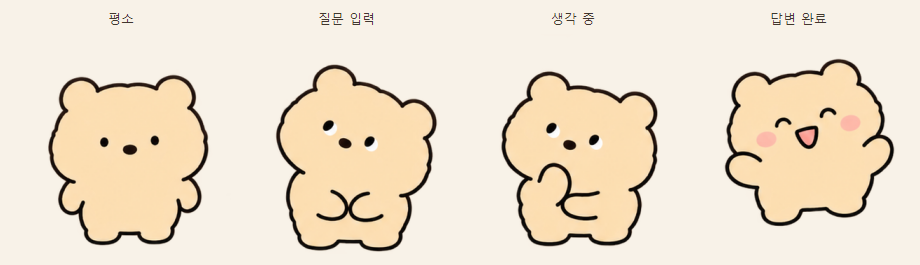

# 제미곰 (Gemeow)

**제미냥이에서 이어진, 바탕화면 AI 친구**

작업하다 잠깐 말을 걸고, 짧은 대화로 기분을 환기할 수 있는 작은 프로그램입니다. 바탕화면의 캐릭터를 더블클릭하면 대화창이 열리고, Gemini API로 답변을 받습니다. 가볍게 켜 두고 부담 없이 한두 마디 나누는 경험을 목표로 합니다.

기본 설정에서는 작업 중인 다른 창 위에 캐릭터가 머뭅니다. 별도의 AI 창을 찾아가는 과정을 줄이고, 떠오른 질문을 작업 흐름 가까이에서 건넬 수 있도록 만들었습니다.

시작은 고양이 사진을 띄운 **제미냥이**였습니다. 직접 사용하면서 “방금 나눈 이야기를 왜 기억하지 못할까?”, “답변을 기다리는 동안 왜 창도 멈출까?”라는 불편이 드러났습니다. 그 경험을 바탕으로 대화가 이어지는 방식과 화면 처리 구조를 고치고, 상태에 따라 반응하는 곰 캐릭터와 편의 기능을 더한 것이 현재의 제미곰입니다.

응답을 짧게 요청하고, 다음 답변에 참고할 최근 대화 수를 조절할 수 있습니다. 자주 쓰는 개인용 도구인 만큼 **대화의 편안함과 API 사용량을 함께 고려**했습니다.

## 제미냥이에서 무엇이 달라졌나요?

| 구분 | 초기 제미냥이 | 현재 제미곰 |
|---|---|---|
| 대화의 기억 | 기록은 파일에 저장했지만, 질문마다 새 대화를 만들어 앞말을 참고하지 못했습니다. | 선택한 대화의 최근 문답을 모델에 전달하고, 다시 실행해도 기록을 복원합니다. |
| 응답을 기다리는 동안 | 화면 처리와 같은 흐름에서 API 응답을 기다렸습니다. | 별도 Qt 작업 스레드에서 통신하며 답변을 조금씩 표시합니다. |
| 대화 화면 | 질문창과 답변창을 번갈아 열었습니다. | 한 창에서 이전 내용을 읽고 계속 입력합니다. |
| 키와 환경 설정 | API 키를 코드 또는 실행 환경에서 지정했습니다. | 설정창에서 키·모델·말투·기억 범위·외형을 조정합니다. |
| 실패한 질문 | 오류창을 닫고 다시 질문해야 했습니다. | 질문을 보존하고 다시 보내거나 응답을 취소할 수 있습니다. |
| 캐릭터와 반응 | 고양이 사진을 바탕화면에 표시했습니다. | 투명 배경의 곰 캐릭터가 입력·생각·답변 완료에 맞춰 반응합니다. |

초기 버전의 소개는 [이전 README](docs/legacy/README.md)에 보관했습니다.

## 곁에 두고 쓰는 기능

- **네 가지 상태:** 평소에는 쉬고, 질문을 입력하면 대화창을 바라보고, 생각할 때는 턱을 괴고, 답변을 마치면 웃습니다.
- **이어지는 대화:** 대화별 기록을 저장하고, 새 대화와 이전 대화를 선택할 수 있습니다.
- **편한 기록 관리:** 현재 대화 검색, 마지막 답변 복사, 텍스트 내보내기, 삭제, 기존 JSON 기록 가져오기를 지원합니다.
- **실패 후 다시 보내기:** 실패한 질문과 작성 중인 새 초안을 보존합니다. 중복 전송도 막습니다.
- **외형 설정:** 밝은 크림·어두운 밤 테마, 캐릭터 크기, 항상 위 표시, 모션 켜기·끄기를 조정합니다.
- **내 이미지 사용:** 상태별 PNG·GIF를 지정할 수 있습니다.
- **바탕화면 조작:** 캐릭터를 드래그해 옮기고, 트레이 메뉴에서 숨기거나 다시 불러옵니다.

## 실행하기

Windows와 **Python 3.10 이상**이 필요합니다. Python 3.13 환경에서 확인했습니다.

1. 이 저장소 위쪽의 **Code → Download ZIP**으로 파일을 내려받습니다.
2. ZIP 파일을 마우스 오른쪽 버튼으로 클릭하고 **모두 압축 풀기**를 선택합니다.
3. 압축을 푼 폴더에서 **start.cmd**를 더블클릭합니다.
4. 필요한 패키지가 없다는 안내가 나오면 **install.cmd**를 한 번 실행한 뒤 start.cmd를 다시 실행합니다.
5. 설정창에 자신의 **Gemini API 키**를 입력하고 저장합니다.
6. 바탕화면의 곰을 더블클릭해 대화를 시작합니다.

**ZIP 파일 안에서 바로 실행하면 필요한 옆 파일을 찾지 못할 수 있습니다. 반드시 압축을 모두 푼 폴더에서 실행하세요.**

install.cmd는 프로그램 폴더 안의 **.venv**에 패키지를 설치합니다. 기존 Python 환경의 패키지는 바꾸지 않습니다.

Python 설치, API 키 준비, 이전 기록 옮기기와 문제 해결은 [처음 실행하기](docs/GETTING_STARTED.md)에 단계별로 정리했습니다.

| 조작 | 동작 |
|---|---|
| 캐릭터 더블클릭 | 대화창 열기 |
| 캐릭터 드래그 | 위치 이동 |
| Enter | 전송 |
| Shift+Enter / Ctrl+Enter | 줄바꿈 |
| Esc | 대화창 접기 |
| Ctrl+F | 대화에서 찾기 |
| 캐릭터·트레이 메뉴 | 숨기기, 불러오기, 종료 |

대화창의 X 버튼은 창을 접습니다. 프로그램을 완전히 끝내려면 캐릭터나 트레이 메뉴의 종료 항목을 사용하세요.

## 기억 범위와 API 사용량

대화 기록은 로컬에 저장하고, 답변을 만들 때 **선택한 대화의 최근 20회 문답**을 기본 문맥으로 전달합니다. 설정에서 **1~100회**로 바꿀 수 있습니다. 오래된 기록은 계속 열람·내보내기할 수 있으며, 다음 답변에 참고하는 범위는 설정한 최근 문답 수까지입니다. 새 대화를 시작하면 앞 대화의 문맥을 이어받지 않습니다.

기본 말투 설정은 보통 **2~3문장**으로 답하도록 요청합니다. 이는 모델에 주는 지침이므로 모든 답변의 길이를 엄격히 제한하지는 않습니다. 최근 대화도 요청 때 함께 전달되므로, 기억 범위를 크게 잡을수록 입력량이 늘어날 수 있습니다.

실제 요금과 사용 한도는 각자의 Google API 프로젝트, 사용하는 모델과 요청량에 따릅니다. 이 프로젝트에서 비용 절감 효과를 측정하거나 무료 사용을 보장한 것은 아닙니다.

## 키와 대화 기록

API 키는 프로그램의 **설정창**에 입력합니다. 기본값은 이번 실행 동안만 메모리에 유지하는 방식입니다. **이 Windows 계정에 암호화하여 저장**을 선택하면 Windows DPAPI로 보호해 다음 실행에도 사용할 수 있습니다.

대화와 설정은 프로그램 폴더의 **data/gemeow.sqlite3**, 저장을 선택한 키는 **data/api_key.dpapi**에 보관합니다. 개인 대화를 포함한 data 폴더와 API 키는 저장소에 올리거나 다른 사람에게 전달하지 마세요. 프로그램 폴더를 백업하거나 옮길 때는 먼저 정상 종료합니다.

## 사용 중 알아둘 점

- 네트워크 대기에 **30초 시간제한**을 사용합니다. 답변 출력 전의 일시적 통신·서버 오류만 한 번 자동 재시도하며, 인증 오류와 사용량 제한은 반복 요청하지 않습니다.
- **연결 확인**은 키로 모델 정보를 조회하는 기능입니다. 실제 답변 생성이나 사용량·결제 상태까지 확인하지는 않습니다.
- 응답 취소·종료는 현재 네트워크 대기가 끝난 뒤 마무리될 수 있습니다. 실패하거나 취소된 부분 답변은 다음 대화의 기억에 넣지 않습니다.
- 기록 저장에 실패하면 안내를 확인하고 **현재 대화 내보내기**로 받은 답변을 먼저 보관할 수 있습니다.

## 어떻게 만들어졌나요?

짧은 AI 대화를 위한 프로그램을 구상하고, 필요한 기능과 캐릭터의 반응을 정하며 직접 사용해 왔습니다. 초기 제미냥이는 Gemini와 함께 만들었고, 이후 ChatGPT·Codex와의 협업으로 대화 문맥, 화면 응답성, 저장 방식과 편의 기능을 개선했습니다.

어떤 기능을 넣을지, 사용하면서 무엇이 불편했는지, 다음에는 무엇을 바꿀지는 직접 사용한 경험에서 출발합니다. AI와 함께 코드를 작성하고 검증하면서 개인용 프로그램을 계속 다듬는 프로젝트입니다.

구조와 검증 내용은 [개발 기록](DEVELOPMENT.md), 다음 개선 방향은 [로드맵](ROADMAP.md)에서 확인할 수 있습니다.
