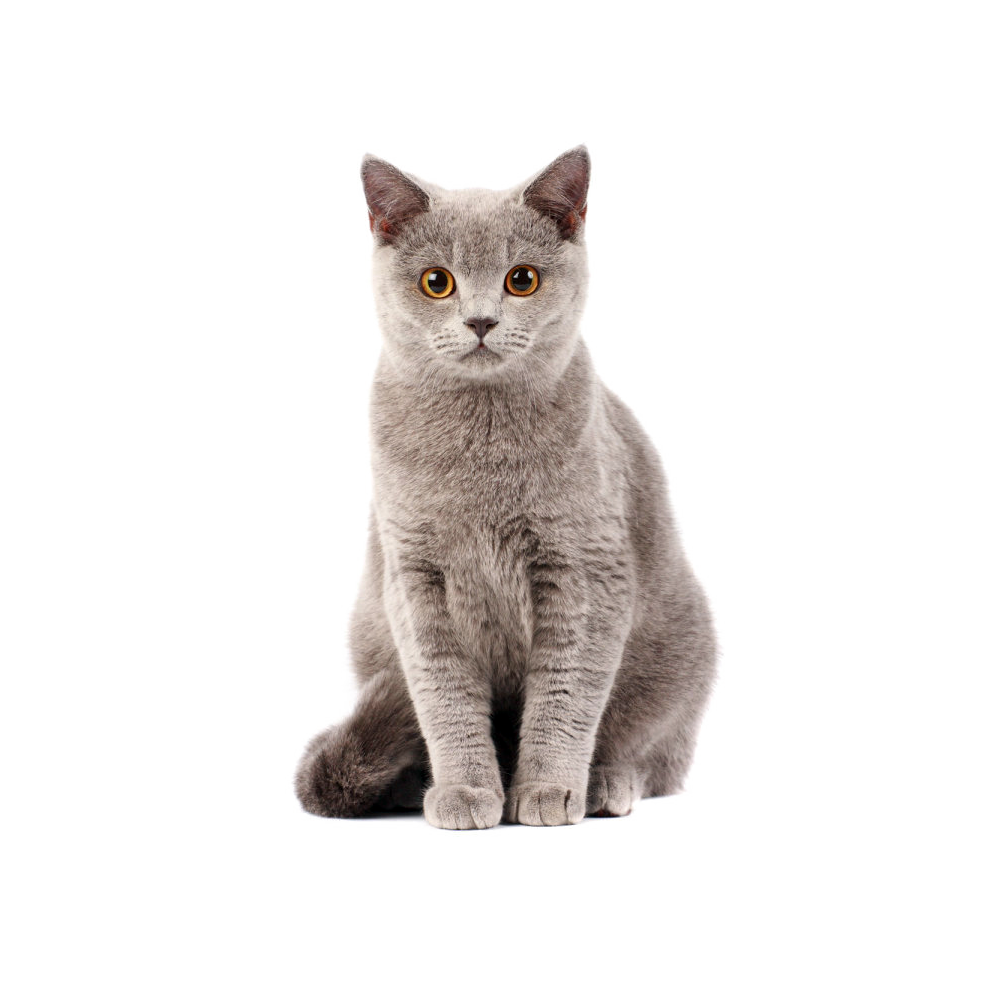

# Gemeow · 제미냥이



**작업 중 떠오른 질문을, 바탕화면의 고양이에게.**

Gemeow는 화면 맨 앞에 두고 사용하는 Python 데스크톱 채팅 프로그램입니다. 고양이를 더블클릭하면 질문창이 열리고, Gemini 3.8 Flash가 짧고 친근한 고양이 말투로 답변하도록 요청합니다.

컴퓨터로 작업하다 짧은 질문을 하고 싶을 때마다 Gemini 창을 찾아 여는 과정이 번거로웠습니다. 작업하던 화면 가까이에서 바로 질문할 수 있도록, 항상 위에 표시되는 고양이 형태의 작은 채팅 도구를 만들었습니다.

작성자: 최준영 · 공개 기록: 2026-10-26

## 현재 구현한 기능

| 기능 | 사용 방법·동작 |
| --- | --- |
| 바탕화면 고양이 | 투명 배경의 테두리 없는 창, 항상 위에 표시하는 옵션 적용 |
| 위치 이동 | 고양이를 마우스 왼쪽 버튼으로 끌어서 이동 |
| 질문하기 | 고양이 더블클릭 → 질문 입력 → Enter 또는 `질문하기` |
| 여러 줄 입력 | Ctrl+Enter로 줄바꿈, 입력창 너비에 맞춰 자동 줄바꿈 |
| 답변 확인 | 별도의 카드형 대화창에 답변 표시 |
| 다시 질문하기 | 답변창에서 다음 질문의 입력창 열기 |
| 대화 기록 | 질문 시각·질문·답변을 로컬 JSON 파일에 저장하고 조회 |
| 종료 | 고양이 우클릭 → `제미냥이 재우기 (종료)` |

**현재 각 질문은 독립적으로 처리됩니다.** `다시 질문하기`는 입력창을 다시 여는 기능이며, 이전 대화 내용을 모델에 전달하지는 않습니다. 다음 목표는 앞선 질문과 답변을 기억하는 연속 대화입니다.

## 사용하면서 바꾼 점

| 불편하거나 필요했던 점 | 선택한 개선 |
| --- | --- |
| 짧은 질문에도 매번 브라우저 창을 찾아야 함 | 화면 맨 앞에 두는 고양이와 더블클릭 입력 |
| 자동으로 돌아다니는 캐릭터가 작업 중 거슬릴 수 있음 | 자동 이동을 없애고 사용자가 옮긴 위치에 머물도록 변경 |
| 작은 입력칸과 가로 스크롤이 불편함 | 여러 줄 입력, 자동 줄바꿈, Enter·Ctrl+Enter 동작 구분 |
| 대화창이 고양이를 가림 | 고양이 위쪽에 배치하고 위 공간이 부족하면 아래쪽에 배치 |
| 지난 답변을 다시 확인하고 싶음 | 대화 기록 저장과 조회 버튼 추가 |
| 답변을 본 뒤 질문을 이어서 입력하고 싶음 | `다시 질문하기` 버튼 추가 |

요구를 정하고 사용 중 생긴 문제를 전달하면서 기능을 반복해서 다듬었습니다. 오류와 수정 과정은 [개발 기록](DEVELOPMENT.md)에 정리했습니다.

## 설치와 실행

개발 중 사용한 환경은 Windows와 Python 3.13입니다. PyQt5와 Google Gen AI SDK를 사용합니다. 다른 운영체제의 동작은 아직 확인하지 않았으며, 정확한 라이브러리 버전 고정은 추가 작업으로 남아 있습니다.

1. 이 저장소에서 **Code → Download ZIP**을 눌러 내려받고 압축을 풉니다.
2. `Gemeow_pet.py`와 `cat.png`가 있는 폴더에서 PowerShell을 엽니다.
3. 아래 명령으로 가상환경을 만들고 필요한 라이브러리를 설치합니다.

```powershell
python -m venv .venv
.\.venv\Scripts\python.exe -m pip install -r requirements.txt
```

4. Google AI Studio에서 발급받은 본인의 API 키를 현재 PowerShell에 설정한 뒤 실행합니다.

```powershell
$env:GEMINI_API_KEY = "YOUR_GEMINI_API_KEY"
.\.venv\Scripts\python.exe .\Gemeow_pet.py
```

`YOUR_GEMINI_API_KEY`는 실제 키로 바꿉니다. 키는 코드 파일에 입력하지 않습니다. 위 설정은 현재 PowerShell 세션에 적용되므로 새 창을 열면 다시 설정해야 합니다. `.env` 파일 자동 읽기는 구현하지 않았습니다.

키를 설정하지 않아도 고양이 창은 열 수 있지만, 질문을 보내면 설정 안내가 표시됩니다. 실제 답변에는 인터넷 연결과 사용 가능한 Gemini API 키가 필요합니다. 이용 가능 모델·요금·호출 한도는 본인 계정의 Google AI Studio에서 확인합니다.

동작 확인 후 콘솔 창 없이 실행하려면, 같은 PowerShell에서 다음 명령을 사용할 수 있습니다.

```powershell
.\.venv\Scripts\pythonw.exe .\Gemeow_pet.py
```

## 파일 안내

| 파일 | 역할 |
| --- | --- |
| [Gemeow_pet.py](Gemeow_pet.py) | 고양이 창, 질문·답변·기록 창, API 요청, 파일 저장 |
| [cat.png](cat.png) | 프로그램에 사용하는 고양이 이미지 |
| [requirements.txt](requirements.txt) | 설치할 외부 라이브러리 목록 |
| [chat_history.example.json](chat_history.example.json) | 실제 대화가 아닌 기록 형식 예시 |
| [DEVELOPMENT.md](DEVELOPMENT.md) | 문제 발견, 기능 선택, 오류 해결 과정 |
| [ROADMAP.md](ROADMAP.md) | 연속 대화를 포함한 다음 개발 계획 |

실행 중 생기는 `chat_history.json`에는 개인 대화가 저장됩니다. 이 파일과 개발 대화 원문은 공개 저장소에 포함하지 않았습니다. 예시 JSON은 설명용이며 프로그램이 자동으로 불러오는 파일은 아닙니다. 질문은 Gemini API로 전송되고, 답변을 받으면 질문과 답변이 로컬 파일에 저장됩니다.

## 현재 한계와 다음 목표

- **연속 대화:** 요청마다 새 채팅을 만들어 앞선 문맥을 이어받지 못합니다. 가장 먼저 개선할 항목입니다.
- **응답 대기:** API 요청을 화면을 처리하는 작업에서 실행하므로, 기다리는 동안 창의 반응이 멈출 수 있습니다.
- **창 배치:** 기본 화면을 기준으로 계산합니다. 다중 모니터·화면 밖 배치와 전체 화면 프로그램에서의 표시를 추가 확인해야 합니다.
- **오류·기록 관리:** 기록 파일 손상과 저장 실패 안내, 빈 응답 처리 등을 더 다듬을 필요가 있습니다.
- **검증:** 응답 시간·자원 사용량은 측정하지 않았습니다. 실제 실행 화면과 시연 영상은 추후 추가할 예정입니다.

세부 작업과 확인 기준은 [개발 계획](ROADMAP.md)에 적었습니다.

## 제작 과정과 AI 활용

사용 목적과 기능 요구, 개선 방향은 직접 정했습니다. Gemini를 코드 초안 작성과 오류 분석에 활용하면서 실행 중 발생한 문제를 전달하고, 입력 방식·창 배치·기록 조회 등 실제 사용에 필요한 수정을 요청했습니다. 공개용 코드 설정과 문서 정리에는 ChatGPT의 도움도 받았습니다.

이 프로젝트는 일상에서 느낀 불편을 기능으로 옮기고, 직접 사용하면서 개선한 과정을 기록합니다.

## 참고 자료

- [Google Gen AI Python SDK](https://github.com/googleapis/python-genai)
- [Gemini 3.8 Flash 공식 모델 안내](https://ai.google.dev/gemini-api/docs/models/gemini-3.8-flash)
- [Qt 스레드와 화면 응답성](https://doc.qt.io/qt-6.8/thread-basics.html)
